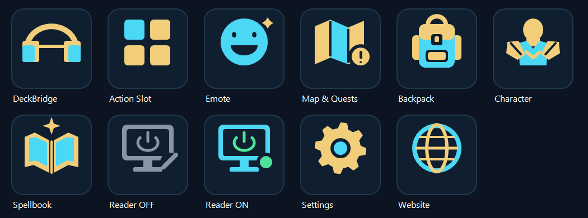

# DeckBridge

[Polski](README.pl.md) · [User guide](USER-GUIDE.en.md) · [Privacy](PRIVACY.md) · [Contributing](CONTRIBUTING.md)

DeckBridge connects World of Warcraft action bars to Elgato Stream Deck on Windows. It includes a WoW addon and a Stream Deck plugin, with matching Duotone artwork.



## Features

- Action Slot: select one of eight zones and one of twelve positions.
- Live ability icons through small on-screen color markers.
- Screen Reader with explicit start/stop control; OFF by default and after the game exits.
- Configurable capture zones: snap to a standard action bar, drag, resize or rotate.
- Emotes, Map & Quests, Backpack, Character and Spellbook actions.

## Requirements and status

Windows 10 or later, Stream Deck software 7.1 or later, and WoW Retail. The addon declares Interface 120105. Other game versions, custom action bars and all display/DPI configurations are not verified. Version 0.1.13 is an initial public preview, not an official Blizzard or Elgato product.

The public name is DeckBridge. Technical identifiers retain `dev` to preserve existing installations: `com.deckbridge.wow.dev`, `DeckBridgeDev`, `DeckBridgeDevDB`. Do not rename these folders or overwrite another DeckBridge installation. Running older and newer editions together may cause conflicting game key bindings.

## Installation

Use a maintainer-provided release package, not GitHub's automatic source ZIP as an installable plugin.

1. Close WoW. Locate your actual Retail installation and copy only `addon/DeckBridgeDev` into its `Interface/AddOns` directory.
2. Locate the Stream Deck user plugin directory: `%APPDATA%/Elgato/StreamDeck/Plugins`. Copy only `com.deckbridge.wow.dev.sdPlugin` from the built release into it. These instructions are for a first installation; stop if the target already exists and back it up before an update. Do not replace SavedVariables or profiles.
3. Start Stream Deck after the initial installation, then start WoW and enable DeckBridge. A later update must restart only this plugin, not other plugins.
4. Log into a character and use `/reload` to write the initial addon data. Add Action Slot to Stream Deck, choose Zone and Slot position, and select the actual `WTF/Account/<account>/SavedVariables/DeckBridgeDev.lua` file when automatic discovery does not select it.
5. Open Zone Settings from the minimap icon or `/dbzones`; configure the zones you use. Add Screen Reader on the same Stream Deck page as Action Slot and press it to enable live updates. WoW must be the foreground window. `/dbcheck` checks utility bindings.

The addon reserves F1–F12 with modifier combinations and Ctrl+Alt+Shift+A–Q. Review conflicts with your own bindings. The first press during helper startup may be dropped; press again after startup. See [the detailed guide](LIVE-ICONS.en.md).

For [updates](USER-GUIDE.en.md#updating), [uninstallation](USER-GUIDE.en.md#uninstalling) and [troubleshooting](USER-GUIDE.en.md#troubleshooting), follow the user guide. Release manifests do not configure a Node.js debugger. See [testing and compatibility notes](TESTING.en.md) before distributing a build.

## Privacy and external resources

Screen capture runs only after explicit consent and while WoW is foreground. Closing the game, removing the required controls, or pressing OFF stops the reader. The plugin and keyboard helper can still run while capture is OFF. Icon files may be downloaded from external services and cached locally. Property inspectors load an external component script. See [PRIVACY.md](PRIVACY.md) for details.

## Build from source

Use Node.js 24 and npm on Windows with Windows PowerShell 5.1 available. From this public source directory:

```powershell
npm.cmd ci
if ($LASTEXITCODE -ne 0) { throw 'Dependency installation failed' }
& .\node_modules\.bin\tsc.cmd --noEmit
if ($LASTEXITCODE -ne 0) { throw 'TypeScript failed' }
npm.cmd run build:dev
if ($LASTEXITCODE -ne 0) { throw 'DEV build failed' }
node --check .\com.deckbridge.wow.dev.sdPlugin\bin\plugin.js
if ($LASTEXITCODE -ne 0) { throw 'JavaScript syntax failed' }
node scripts/check-dev-package.cjs
if ($LASTEXITCODE -ne 0) { throw 'Package check failed' }
node scripts/generate-notices.cjs
if ($LASTEXITCODE -ne 0) { throw 'License notices failed' }
node scripts/package-dev-fresh.cjs
if ($LASTEXITCODE -ne 0) { throw 'Packaging failed' }
```

Each package is written to a new `dev-release-*` directory. It includes per-file SHA-256 checksums and does not install anything. The build targets the plugin identifier listed above. See [CONTRIBUTING.md](CONTRIBUTING.md) for tests and artwork sources.

The public dependency manifest explicitly overrides Zod to 4.6.6 to address [GHSA-mrhx-c7xc-m3w5](https://github.com/advisories/GHSA-mrhx-c7xc-m3w5). This is outside the range originally declared by `@elgato/utils`; compatibility is covered by tests of the actual RPC and option-list schemas used by the SDK, plus the build and project tests. A real device test is still required for this freshly built package.

## License and credits

Original project code and Duotone artwork are licensed under [MIT](LICENSE), copyright 2026 Citru5Kick. Dependencies retain their own licenses; release packages include their full notices in `THIRD_PARTY_NOTICES.txt`. Game icons, game assets, trademarks and remotely loaded resources are not relicensed under MIT. Game icons and local user data are not shipped in this source repository.

World of Warcraft belongs to Blizzard Entertainment. Stream Deck belongs to Elgato/Corsair. DeckBridge is an independent community project.
